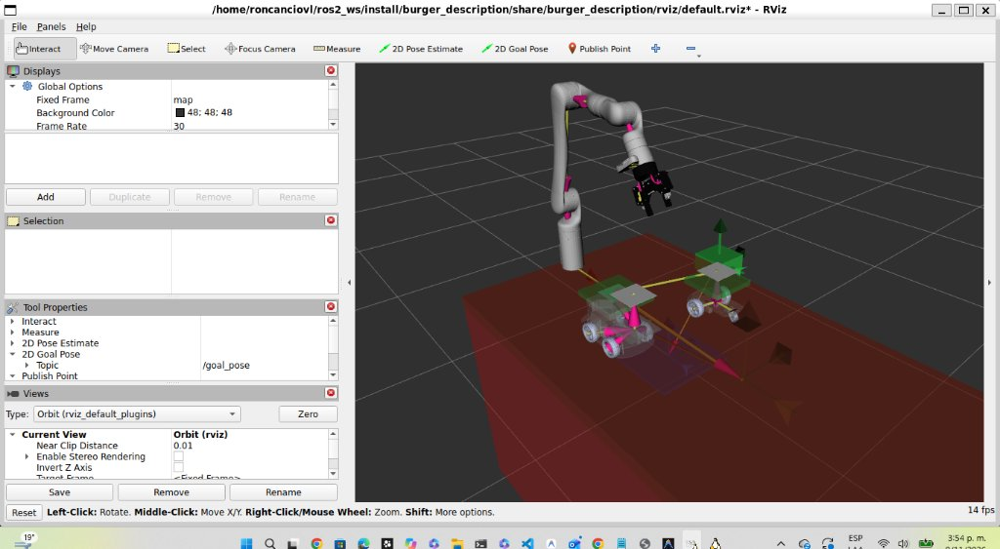

# Burger Description Package

> [!NOTE]
> **El modelo vendorizado es el del robot del laboratorio: Gen3 de 6 GDL, pinza Robotiq 2F-85 y
> módulo de visión** (re-vendorizado desde `kortex_description/arms/gen3/6dof` con
> `scripts/revendorizar_gen3_6dof.py --vision`, que también regenera `visual/burger_delivery_gen3.urdf`).
> Los frames de la cámara, `gen3_camera_link`, `gen3_camera_color_frame` y `gen3_camera_depth_frame`,
> cuelgan de `gen3_end_effector_link`.
>
> Conviene no confundir dos modelos que coexisten en el workspace:
>
> | Modelo | Cadena cinemática | GDL |
> | :--- | :--- | :---: |
> | `kortex_description`, generado en vivo por el driver | `base_link → shoulder_link → bicep_link → forearm_link → …` | 6 |
> | `burger_description` (vendorizado) | `gen3_base_link → gen3_shoulder_link → gen3_bicep_link → gen3_forearm_link → …` | 6 |
>
> Tienen la misma cinemática, pero el de `burger_description` lleva todos sus frames bajo el
> prefijo `gen3_` y lo publica `display.launch.py`. Sin argumentos es un visor sin robot,
> movido por el deslizador. Con `robot_real:=true` muestra la escena completa del
> laboratorio con la pose real del brazo: `scene_joint_relay.py` copia `/joint_states` del
> driver a `/scene/joint_states` con el prefijo `gen3_`. El RViz que abre
> `kinova_connection.launch.py` con `launch_rviz:=true` usa el modelo del driver, sin la
> escena. Los URDF de referencia de Kinova en `vendor/robots/` siguen siendo
> los originales de 7 GDL.


This package contains the URDF description for the Burger Delivery Robot.

## Prerequisites

- ROS 2 Jazzy
- `colcon` build tool

## Installation

1.  Clone or copy this package into your ROS 2 workspace `src` directory.
    ```bash
    mkdir -p ~/ros2_ws/src
    cp -r /path/to/burger_description ~/ros2_ws/src/
    ```

2.  Build the workspace.
    ```bash
    cd ~/ros2_ws
    colcon build --packages-select burger_description
    ```

3.  Source the setup script.
    ```bash
    source install/setup.bash
    ```

## Usage

### Lanzar Visualización (Nodo 1: robot_state_publisher)

**Terminal 1 - Visualización:**
```bash
cd ~/ros2_ws
source install/setup.bash
ros2 launch burger_description display.launch.py
```

Esto lanza automáticamente:
- `robot_state_publisher` - Publica TF
- `joint_state_publisher_gui` - GUI para mover articulaciones manualmente
- `rviz2` - Visualización 3D

**Configuración en RViz:**
- En el panel izquierdo "Global Options" → **Fixed Frame** → Selecciona `map`
- Verifica que estén habilitados: ✓ RobotModel, ✓ TF



### Escena del laboratorio con el Kinova real

Con el driver corriendo en la estación anfitriona del mismo `ROS_DOMAIN_ID` (ver
`burger_kinova_reference`), la misma escena se mueve con la pose real del brazo:

```bash
ros2 launch burger_description display.launch.py robot_real:=true use_static_carts:=true
```

En este modo no se abre el deslizador. `scene_joint_relay.py` copia `/joint_states` del
driver a `/scene/joint_states` con el prefijo `gen3_`, y la escena se publica en
`/scene/robot_description` para no pisar el `/robot_description` del driver. RViz abre
`rviz/laboratorio.rviz`. Solo lee estado y no envía comandos, así que también funciona
en una estación cliente. Con `use_static_carts:=false`, los TF `tag_mesa → tag_carrito{1,2}`
quedan a cargo del localizador AprilTag.

Con el driver fake, añade `use_fake_hardware:=true`. Ese driver se lanza sin la pinza, y sin
este argumento RViz marca `Status: Error` porque sus eslabones no tienen TF. El relé la publica
abierta en la escena. No lo uses con el robot real: ocultaría una pinza que no publica su estado.

En los dos modos, el display `ColisionMesa` de RViz dibuja en rojo la caja de colisión de la
mesa, tal como la lee `scene_collision_markers.py` del URDF de la escena. Es la misma caja que
`escena_moveit` carga en MoveIt, y se oculta con su casilla. Tiene las medidas de la mesa real
(2.0 × 0.9 m y 0.92 m de alto) y baja hasta el piso para cubrir las patas, aunque el tablero
visible mida 5 cm. La base del brazo va al borde del lado de 0.9 m, aproximadamente en la mitad.
Fuera de esa caja, MoveIt puede planificar por debajo de la superficie.

### Lanzar Tu Nodo de Control (Nodo 2: Controlador)

**Opción A: Nodo Python simple**

1. Crea el archivo `~/ros2_ws/src/arm_controller.py`:
```python
import rclpy
from rclpy.node import Node
from sensor_msgs.msg import JointState

class SimpleArmController(Node):
    def __init__(self):
        super().__init__('simple_arm_controller')
        self.pub = self.create_publisher(JointState, '/joint_states', 10)
        self.timer = self.create_timer(0.1, self.move_arm)
        
    def move_arm(self):
        msg = JointState()
        msg.header.stamp = self.get_clock().now().to_msg()
        msg.name = ['gen3_joint_1', 'gen3_joint_2', 'gen3_joint_3', 
                    'gen3_joint_4', 'gen3_joint_5', 'gen3_joint_6']
        msg.position = [0.0, 0.5, 0.0, 1.0, 0.0, 0.5]
        self.pub.publish(msg)

def main():
    rclpy.init()
    node = SimpleArmController()
    rclpy.spin(node)

if __name__ == '__main__':
    main()
```

2. **Terminal 2 - Controlador:**
```bash
cd ~/ros2_ws/src
python3 arm_controller.py
```

**Opción B: Con MoveIt2 (recomendado)**

```bash
# Terminal 2 - MoveIt2
ros2 launch moveit_config demo.launch.py
```

### Workflow Completo

```bash
# Terminal 1: Visualización (siempre primero)
ros2 launch burger_description display.launch.py

# Terminal 2: Tu controlador (después de ver RViz)
python3 arm_controller.py

# Terminal 3 (opcional): Monitorear topics
ros2 topic echo /joint_states
```


This will launch:
- `robot_state_publisher`
- `joint_state_publisher_gui`
- `rviz2` (with pre-configured displays for RobotModel and TF)

### RViz Configuration

**Important:** In RViz, set the **Fixed Frame** to `map` in the "Global Options" panel (left sidebar). This ensures the entire scene (robot arm, mobile robots, table, etc.) is visible.

## Robot Components

This URDF includes:
- **Kinova Gen3 (6 DOF)** - Ultra-lightweight robotic arm, igual que el brazo del laboratorio
- **2F Adapter** - Pinza simple
- **Scene elements** - Table, staging area, delivery slots, mobile robot bases

## Integration with Motion Control Nodes

### Architecture Overview: Two Independent Nodes

Your robot control system consists of **two separate nodes**:

```
┌─────────────────────────────────────────────────────────┐
│  NODO 1: robot_state_publisher (Ya incluido)           │
│  ────────────────────────────────────────────────────   │
│  Función: Publicar TF (transformaciones 3D)            │
│  Input:  /joint_states (ángulos de articulaciones)     │
│  Output: /tf (posiciones 3D de cada link)              │
│  Estado: ✓ Ya corriendo cuando lanzas display.launch   │
└─────────────────────────────────────────────────────────┘
                            ▲
                            │ lee /joint_states
                            │
┌─────────────────────────────────────────────────────────┐
│  NODO 2: Tu controlador de movimiento (Por crear)      │
│  ────────────────────────────────────────────────────   │
│  Función: Planificar y ejecutar trayectorias           │
│  Input:  Objetivo (ej: "agarrar hamburguesa en X,Y,Z") │
│  Output: /joint_states (ángulos calculados)            │
│  Estado: ✗ Debes crearlo                               │
└─────────────────────────────────────────────────────────┘
```

**Resumen:**
- **Nodo 1** (robot_state_publisher): Convierte ángulos → posiciones 3D (ya funciona)
- **Nodo 2** (tu controlador): Calcula qué ángulos enviar para mover el brazo

### 1. Opción Simple: Publicar Ángulos Directamente

Para pruebas rápidas, publica ángulos manualmente:

```python
import rclpy
from rclpy.node import Node
from sensor_msgs.msg import JointState

class SimpleArmController(Node):
    def __init__(self):
        super().__init__('simple_arm_controller')
        self.pub = self.create_publisher(JointState, '/joint_states', 10)
        self.timer = self.create_timer(0.1, self.move_arm)
        
    def move_arm(self):
        msg = JointState()
        msg.header.stamp = self.get_clock().now().to_msg()
        msg.name = ['gen3_joint_1', 'gen3_joint_2', 'gen3_joint_3', 
                    'gen3_joint_4', 'gen3_joint_5', 'gen3_joint_6']
        msg.position = [0.0, 0.5, 0.0, 1.0, 0.0, 0.5]  # Ángulos en radianes
        self.pub.publish(msg)

def main():
    rclpy.init()
    node = SimpleArmController()
    rclpy.spin(node)
```

**Limitación:** Debes calcular los ángulos manualmente (cinemática inversa).

### 2. Opción Recomendada: MoveIt2 (Planificador Avanzado)

MoveIt2 calcula automáticamente los ángulos necesarios para alcanzar una posición XYZ:

```bash
# Instalar MoveIt2
sudo apt install ros-jazzy-moveit

# Generar configuración para este robot
ros2 run moveit_setup_assistant moveit_setup_assistant
```

Luego carga el URDF desde: `~/ros2_ws/install/burger_description/share/burger_description/urdf/burger_delivery_gen3.urdf`

**Ventajas:**
- Cinemática inversa automática (das XYZ, MoveIt calcula ángulos)
- Evita colisiones
- Planifica trayectorias suaves

### 3. Control de Hardware Real (ros2_control)

El URDF ya incluye configuración `ros2_control` para el Kinova Gen3:
- **IP del robot:** 192.168.11.11 (definido en URDF línea 866)
- **Driver:** `kortex2_driver/KortexMultiInterfaceHardware`

Para conectar al robot real:
```bash
# Ver guía de instalación en: ros2_setup/INSTALACION_KORTEX.md
ros2 launch kortex_bringup gen3.launch.py robot_ip:=192.168.1.10
```

### 4. Coordinate Frames para Pick-and-Place

Frames clave en el árbol TF (usa con `tf2` para obtener posiciones):
- `gen3_end_effector_link` - Punta del gripper
- `burger_grip_frame` - Punto de agarre optimizado (+18cm desde end effector)
- `delivery_slot_1` - Ubicación de entrega de hamburguesas
- `robot_a_tray_frame`, `robot_b_tray_frame` - Bandejas de robots móviles

**Ejemplo de uso:**
```python
from tf2_ros import Buffer, TransformListener

# Obtener posición del gripper respecto a la mesa
tf_buffer = Buffer()
tf_listener = TransformListener(tf_buffer, node)
transform = tf_buffer.lookup_transform('table_link', 'gen3_end_effector_link', rclpy.time.Time())
```

## Micro-ROS Debugging 📡

For issues related to micro-ROS communication (ESP32 connectivity, agent issues), we provide automatic diagnostic scripts for both operating systems.

**1. Windows (PowerShell):**
```powershell
..\network_setup\diagnostico_microros.ps1
```

**2. Linux (Bash/WSL):**
```bash
chmod +x ../network_setup/diagnostico_microros.sh
../network_setup/diagnostico_microros.sh
```

For a detailed guide on interpreting results, firewall configuration, and router settings (AP Isolation), please refer to the root documentation:

[👉 Go to Detailed Micro-ROS Debugging Guide](../../README.md#diagnóstico-de-comunicación-micro-ros)


