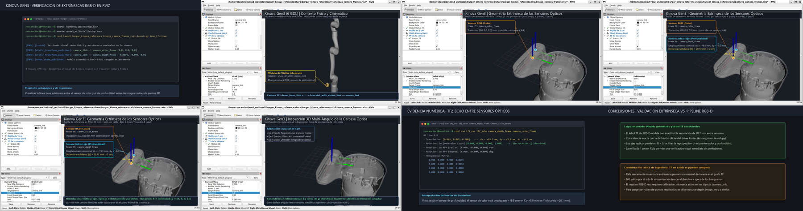

# Demostración visual de los frames RGB y profundidad del Kinova

## Propósito

La demostración permite distinguir los dos marcos ópticos de la cámara y observar su
extrínseca sin confundir visualización con medición. La geometría proviene del
`kinova_vision.launch.py` oficial:

| Transformación publicada | Traslación (m) | Rotación RPY (rad) |
|---|---:|---:|
| `camera_link → camera_color_frame` | `(0, 0, 0)` | `(0, 0, 0)` |
| `camera_link → camera_depth_frame` | `(-0.0195, -0.005, 0)` | `(0, 0, 0)` |

Los sensores tienen ejes paralelos y sus centros están separados aproximadamente 20,1 mm.
Por eso la configuración de RViz usa una rejilla de 1 cm, una cámara muy cercana y ejes de
4 cm. En una vista normal del robot esta separación sería casi imperceptible.

La escena también carga el mesh oficial del Gen3 de 6 GDL con el módulo de visión. El modelo
usa frames auxiliares con prefijo `demo_` y se alinea con `camera_link`; de esta manera aporta
contexto visual sin sustituir ni duplicar la extrínseca publicada para la demostración.

## Ensayo sin robot

Este modo no abre RTSP ni publica imágenes. Publica únicamente dos transformaciones estáticas
nominales para preparar la explicación y grabar el video:

```bash
source /opt/ros/jazzy/setup.bash
source ~/ros2_ws/install/setup.bash
ros2 launch burger_kinova_reference kinova_camera_frames_rviz.launch.py \
  demo_tf:=true
```

En RViz deben aparecer `camera_link`, `camera_color_frame` y `camera_depth_frame`. Los dos
primeros coinciden; el frame de profundidad aparece desplazado hacia el lado negativo de X e
Y. El display `Mesh Kinova Gen3` muestra inicialmente el brazo completo y semitransparente.
Gira suavemente la vista con el botón izquierdo y acerca la rueda hacia la muñeca para pasar
al detalle de los sensores.

En otra terminal muestra el valor numérico:

```bash
ros2 run tf2_ros tf2_echo camera_depth_frame camera_color_frame
```

El comando debe mostrar rotación identidad y una separación de 19,5 mm y 5 mm. La señal de
la traslación depende del orden de los frames solicitado a `tf2_echo`; lo importante es decir
explícitamente qué frame es origen y cuál es destino.

> **No uses `demo_tf:=true` si `kinova_vision` u otro launch ya publica estos frames.** Dos
> autoridades para el mismo enlace TF hacen ambigua la demostración.

## Uso con el árbol TF real

Cuando el sistema real ya publique ambos frames, abre sólo el visor:

```bash
ros2 launch burger_kinova_reference kinova_camera_frames_rviz.launch.py
```

En este modo el visor no crea un robot de demostración: el mesh procede del
`/robot_description` y del árbol TF publicados por el driver real.

Comprueba antes que existe una única autoridad por enlace:

```bash
ros2 topic echo /tf_static --once
ros2 run tf2_ros tf2_echo camera_depth_frame camera_color_frame
```

La escena de RViz demuestra la relación geométrica. No demuestra por sí sola que las imágenes
estén sincronizadas, calibradas o correctamente registradas; eso requiere revisar
`CameraInfo`, marcas de tiempo y el resultado de `depth_image_proc`.

## Guion propuesto para un video de 45–60 segundos

1. **0–8 s — contexto.** Muestra el comando de lanzamiento y explica que es un ensayo offline
   de las extrínsecas nominales, sin abrir la cámara.
2. **8–18 s — contexto físico.** Aleja la vista hasta mostrar el mesh del Gen3 y señala dónde
   está integrado el módulo de visión en la muñeca.
3. **18–35 s — vista macro.** Acércate a la cámara, señala ambos frames y usa la rejilla para
   mostrar que la separación es cercana a 2 cm.
4. **35–47 s — transformación.** Gira lentamente la vista, expande `TF de la cámara` y muestra
   los nombres y la flecha entre frames.
5. **47–55 s — evidencia numérica.** Cambia a la terminal con `tf2_echo` y destaca la
   traslación y la rotación identidad.
6. **55–60 s — conclusión.** Aclara que RViz visualiza la extrínseca, pero no valida por sí
   solo la sincronización ni el registro RGB-D.

## Grabación y video de demostración

Video de demostración generado con esta escena:
- 🎬 **Video MP4 (62 s, 1080p, H.264):** [`kinova_frames_rgbd_demo.mp4`](../videos/kinova_frames_rgbd_demo.mp4)
- 🖼️ **Hoja de contactos (previsualización de secuencias):** [`contacto_video_final.png`](../videos/contacto_video_final.png)



Es una demostración offline y explicativa de las extrínsecas nominales en tres secuencias:
1. **0–18 s:** Contexto general del manipulador Kinova Gen3 de 6 GDL y ubicación del módulo de visión en la muñeca.
2. **18–44 s:** Vista macro y zoom hacia los marcos ópticos `camera_color_frame` y `camera_depth_frame` sobre la rejilla métrica de 1 cm.
3. **44–62 s:** Inspección de la traslación nominal con `tf2_echo` ($\Delta x = 19.5\text{ mm}$, $\Delta y = 5.0\text{ mm}$, rotación identidad).

### Grabación manual en esta estación WSL

1. Da foco a la ventana de RViz.
2. Pulsa **Win+Alt+R** para iniciar la grabación.
3. Sigue el guion y vuelve a pulsar **Win+Alt+R** para detenerla.
4. Busca el MP4 en `Videos/Captures` de Windows.

La Barra de juegos normalmente captura una aplicación por vez. Si el video debe alternar sin
cortes entre RViz y la terminal, instala OBS Studio en Windows y usa *Captura de pantalla*;
configura 1920×1080, 30 fps y salida MP4 o MKV.

## Criterio de logro

La persona participante puede ubicar físicamente el módulo de visión en el mesh, identificar
los tres frames, explicar por qué RGB coincide con `camera_link`, interpretar el desplazamiento
del sensor de profundidad y distinguir una extrínseca TF de una validación completa del
pipeline RGB-D.
